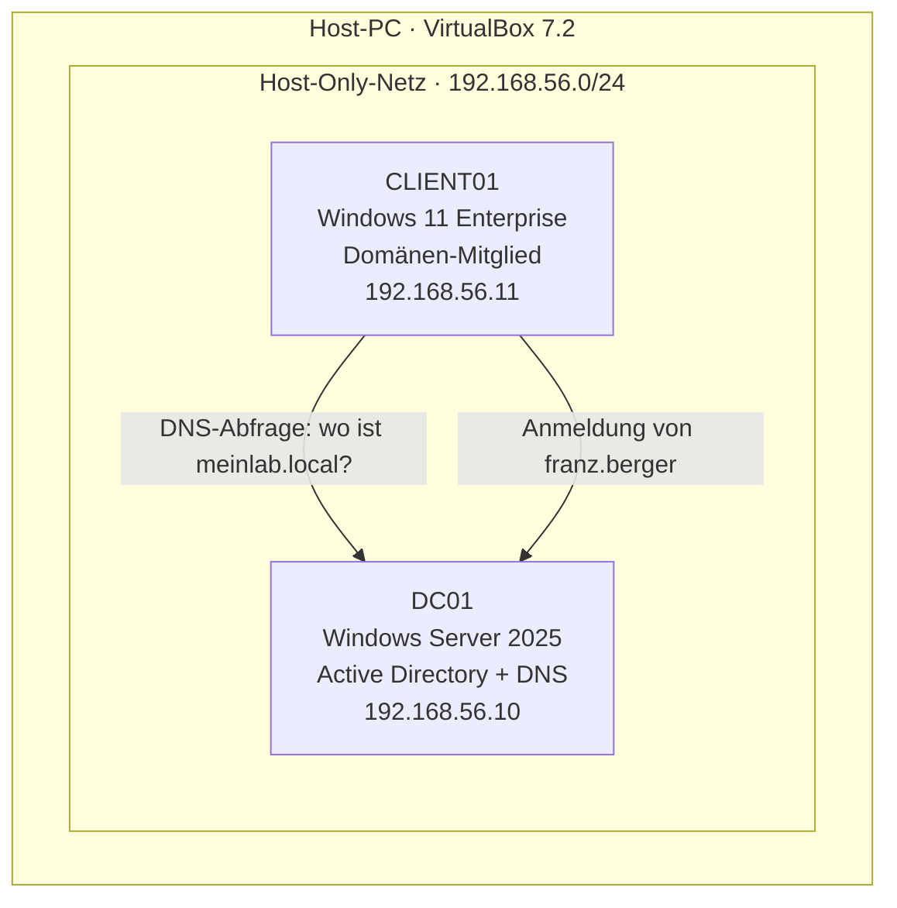

# Windows Server Home-Lab — Active Directory Firmenumgebung

Ein von Grund auf aufgebautes Windows-Server-Lab, das die IT-Zentrale einer Firma
nachbildet: ein Domänencontroller mit **Active Directory** und **DNS**, dazu ein
Windows-11-Client, der der Domäne beitritt. Benutzer, Gruppen, Organisationseinheiten
und eine Gruppenrichtlinie zeigen den vollständigen Verwaltungs-Kreislauf.

> **Aussage dieses Projekts:** Ich kann eine Windows-Firmenumgebung aufsetzen und
> zentral verwalten — vom Server über die Benutzerverwaltung bis zum Client.

---

## Architektur



- **Domäne:** `meinlab.local` (NetBIOS: `MEINLAB`)
- **Netzwerk:** privates, abgeschottetes Host-Only-Netz — kein Internet-Zugang nötig
- **DNS:** läuft auf dem Domänencontroller selbst (DC zeigt mit DNS auf sich, der Client auf den DC)

---

## Komponenten

| Rolle | System | IP | Aufgabe |
|-------|--------|----|---------|
| Domänencontroller | Windows Server 2025 (Eval) | 192.168.56.10 | Active Directory, DNS |
| Client | Windows 11 Enterprise (Eval) | 192.168.56.11 | Mitarbeiter-PC, der Domäne beigetreten |

---

## Umgesetzte Schritte

1. **Virtualisierung:** VirtualBox installiert, zwei VMs angelegt (Platten/Daten auf separatem Laufwerk).
2. **Server aufgesetzt:** Windows Server 2025 installiert, Rechner umbenannt (`DC01`), **feste IP** vergeben.
3. **Active Directory:** Rolle *AD DS* installiert und den Server zum **Domänencontroller** der neuen Domäne `meinlab.local` befördert; **DNS** wird dabei automatisch eingerichtet.
4. **Struktur angelegt:** Organisationseinheiten (OUs) `Buchhaltung` und `IT`, Benutzer `Franz Berger` und `Mark Keller`, Sicherheitsgruppen `Buchhaltung` und `IT`.
5. **Client angebunden:** Windows 11 installiert, feste IP vergeben, **der Domäne beigetreten** (`CLIENT01`).
6. **Login bewiesen:** Anmeldung am Client als Domänen-Benutzer `MEINLAB\franz.berger`.
7. **Gruppenrichtlinie (GPO):** Regel „Systemsteuerung sperren" erstellt und mit der OU `Buchhaltung` verknüpft — greift gezielt nur für die Buchhaltung.

---

## Nachweise

| Screenshot | Zeigt |
|------------|-------|
| `screenshots/01_aduc_struktur.png` | Active Directory mit OUs, Benutzern und Gruppen |
| `screenshots/02_franz_login_client.png` | Domänen-Benutzer Franz am Client angemeldet |
| `screenshots/03_gpo_blockiert_franz.png` | GPO greift: Systemsteuerung für Franz gesperrt |

### Verifikation über DNS (vom Host aus abgefragt)

```text
meinlab.local               ->  192.168.56.10   (Domäne existiert)
dc01.meinlab.local          ->  192.168.56.10   (Domänencontroller findbar)
_ldap._tcp.dc._msdcs...     ->  dc01:389        (echter DC, LDAP-Dienst)
client01.meinlab.local      ->  192.168.56.11   (Client hat sich selbst registriert)
```

Der letzte Eintrag beweist die Domänen-Mitgliedschaft: Der Client trägt sich beim
Beitritt **selbstständig** im DNS des Servers ein.

---

## Eingesetzte Konzepte

Active Directory · Domänencontroller · DNS (Namensauflösung) · Organisationseinheiten (OU) ·
Sicherheitsgruppen · Gruppenrichtlinien (GPO) · Domänenbeitritt · statische IP-Adressierung ·
Host-Only-Netzwerk · Authentifizierung & Autorisierung

---

## Herausforderungen & Lösungen

Realistische Stolpersteine, die beim Aufbau auftraten und gelöst wurden:

| Problem | Ursache | Lösung |
|---------|---------|--------|
| Schwarzer Bildschirm nach Server-Neustart | Grafikchip `VBoxSVGA` ohne Gasterweiterungen | Auf `VBoxVGA` umgestellt |
| Windows 11 verweigert die Installation | TPM 2.0 / Secure Boot / EFI fehlten | In der VM virtuell bereitgestellt |
| Windows-11-Ersteinrichtung verlangt Internet/Microsoft-Konto | Abgeschottetes Lab-Netz | Lokales Konto per `ms-cxh:localonly` erstellt |
| Domänenbeitritt findet die Domäne nicht | DNS-Dienst des Servers nach Standby nicht erreichbar | Server sauber neu gestartet, DNS per Abfrage verifiziert |

---

*Aufgebaut im Coach-Modus als Lern- und Bewerbungsprojekt. Verwendete Microsoft-Evaluierungslizenzen
(Server 2025: 180 Tage, Windows 11 Enterprise: 90 Tage) — kostenlos und ohne Produktschlüssel.*
